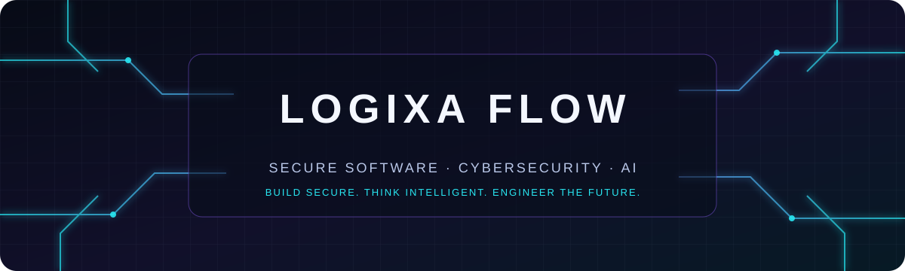

<!-- LOGIXA FLOW | GitHub Profile README -->

  

<h1 align="center">LOGIXA FLOW</h1>

  <strong>Founder · Software Engineering · Cybersecurity · AI Engineering</strong>

  <a href="https://github.com/logixaflow">GitHub</a> ·
  <a href="https://github.com/logixaflow/Logixa-Flow">Featured Project</a>

---

## About

I'm the founder of **Logixa Flow**. I’m developing my skills and building software with an emphasis on secure engineering, thoughtful architecture, and practical AI applications.

My current interests:

- Secure software development and application security
- Backend systems, APIs, and system design
- AI engineering and intelligent automation
- Testing, reliability, and maintainable code
- Open-source collaboration

## Current Focus

- Building and improving the **Logixa Flow** project
- Strengthening application security practices
- Learning scalable backend and software architecture
- Exploring practical AI-powered workflows
- Improving code quality through testing and review

## Featured Project

### [Logixa Flow](https://github.com/logixaflow/Logixa-Flow)

My primary project: an ongoing software engineering effort focused on secure, reliable, and intelligent software systems.

[View the repository →](https://github.com/logixaflow/Logixa-Flow)

## Engineering Interests

| Domain | Areas of interest |
| --- | --- |
| Software Engineering | Application development, clean code |
| Cybersecurity | Secure coding, vulnerability prevention |
| AI Engineering | AI-powered applications, automation |
| Backend Engineering | APIs, architecture, data flow |
| Quality Engineering | Testing, reliability, maintainability |

## Principles

- **Security by design** — consider security throughout development.
- **Clarity over cleverness** — prefer understandable, maintainable solutions.
- **Test before shipping** — validate behavior and edge cases.
- **Keep improving** — learn, measure, and iterate.

## Connect

- GitHub: [@logixaflow](https://github.com/logixaflow)
- Project: [Logixa-Flow](https://github.com/logixaflow/Logixa-Flow)

---

  <strong>BUILD SECURE. THINK INTELLIGENT. ENGINEER THE FUTURE.</strong>

