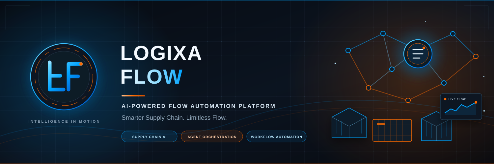

  

  
  
  
  
  
  
  

---

  <strong>An AI-powered multi-agent orchestration and workflow automation platform with LLM routing, RAG pipelines, and real-time monitoring.</strong>

  LLM routing · orchestration · RAG · automation

---

  
  &nbsp;
  

